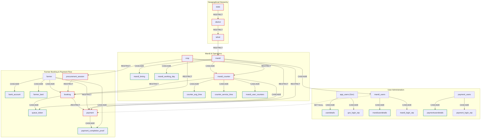

# Database Deletion Order & Foreign Key Dependency Guide (`farmer_db`)

> **Executive Summary**: This document defines the exact, dependency-safe deletion order for MySQL tables in the `farmer_db` ecosystem (shared across Government Portal, Mandi Portal, Farmer Portal, and Payment Portal).
>
> Because critical relationships enforce `ON DELETE RESTRICT` to protect financial audit trails, queue integrity, and statutory procurement quotas, deleting parent records directly will trigger MySQL foreign key violation errors (`ERROR 1451 (23000): Cannot delete or update a parent row: a foreign key constraint fails`).
>
> Follow the precise reverse-dependency sequences and transactional recipes documented below.

---

## Table of Contents

1. [Why Constraints Are Strict](#1-why-constraints-are-strict)
2. [Constraint Action Types Overview](#2-constraint-action-types-overview)
3. [Global Entity Dependency Matrix](#3-global-entity-dependency-matrix)
4. [Visual Dependency Hierarchy (Mermaid)](#4-visual-dependency-hierarchy-mermaid)
5. [Step-by-Step Deletion Recipes](#5-step-by-step-deletion-recipes)
   - [Recipe 1: Deleting a Mandi Counter (`mandi_counter`)](#recipe-1-deleting-a-mandi-counter-mandi_counter)
   - [Recipe 2: Deleting a Booking (`booking`)](#recipe-2-deleting-a-booking-booking)
   - [Recipe 3: Deleting a Mandi (`mandi`)](#recipe-3-deleting-a-mandi-mandi)
   - [Recipe 4: Deleting a Farmer (`farmer`)](#recipe-4-deleting-a-farmer-farmer)
   - [Recipe 5: Deleting a Crop (`crop`)](#recipe-5-deleting-a-crop-crop)
   - [Recipe 6: Deleting a Procurement Session (`procurement_session`)](#recipe-6-deleting-a-procurement-session-procurement_session)
   - [Recipe 7: Deleting a Procurement Quota (`procurement_quota`)](#recipe-7-deleting-a-procurement-quota-procurement_quota)
   - [Recipe 8: Deleting Users & Profile Details (`app_users`, `mandi_users`, `payment_users`)](#recipe-8-deleting-users--profile-details)
   - [Recipe 9: Deleting Geographical Entities (`tehsil`, `district`, `state`)](#recipe-9-deleting-geographical-entities)
6. [SQL Triggers & Direct Deletion Restrictions](#6-sql-triggers--direct-deletion-restrictions)
7. [MongoDB Audit & History Synchronization](#7-mongodb-audit--history-synchronization)
8. [Why You Must NEVER Use `SET FOREIGN_KEY_CHECKS = 0;`](#8-why-you-must-never-use-set-foreign_key_checks--0)
9. [Quick Reference Cheat Sheet](#9-quick-reference-cheat-sheet)

---

## 1. Why Constraints Are Strict

The procurement portal handles real-time commodity trading, queue slot allocation, and Direct Benefit Transfer (DBT) bank disbursements. 

Strict constraints (`ON DELETE RESTRICT`) are purposefully configured to guarantee:
- **No Orphaned Payments**: A payment cannot exist without a verified booking and farmer.
- **No Invisible Queue Tokens**: A physical token cannot point to a deleted counter or invalid booking.
- **Audit & Financial Accountability**: Government expenditure and MSP records cannot be accidentally deleted by modifying operational counters or crops.
- **Identity Integrity**: Profile details cannot be detached from authentic user accounts.

---

## 2. Constraint Action Types Overview

In MySQL InnoDB:
- 🔴 **`ON DELETE RESTRICT` / `NO ACTION`**: Prevents parent row deletion if any child row references it. You **must manually delete the child row first**.
- 🟢 **`ON DELETE CASCADE`**: Automatically deletes all child rows when the parent row is deleted.
- 🟡 **`ON DELETE SET NULL`**: Keeps the child row but sets the referencing foreign key column to `NULL` (e.g., auditing user IDs).
- 🛡️ **SQL Trigger Block (`BEFORE DELETE`)**: Application triggers that deliberately raise SQLSTATE `45000` to prevent direct deletion of profile tables.

---

## 3. Global Entity Dependency Matrix

| Parent Table | Child Table | Foreign Key Column | Delete Action | Reason & Impact |
|---|---|---|---|---|
| `state` | `district` | `district.state_id` | 🔴 **RESTRICT** | Cannot delete state while districts exist |
| `state` | `procurement_quota` | `procurement_quota.state_id` | 🔴 **RESTRICT** | Cannot delete state while quotas exist |
| `state` | `farmer` | `farmer.state_id` | 🔴 **RESTRICT** | Cannot delete state while registered farmers exist |
| `state` | `payment_users` | `payment_users.state_id` | 🔴 **RESTRICT** | Cannot delete state while payment officers exist |
| `state` | `app_users` | `app_users.state_id` | 🟢 **CASCADE** | State admin accounts cascade on state deletion |
| `district` | `tehsil` | `tehsil.district_id` | 🔴 **RESTRICT** | Cannot delete district while tehsils exist |
| `district` | `farmer` | `farmer.district_id` | 🔴 **RESTRICT** | Cannot delete district while farmers exist |
| `district` | `app_users` | `app_users.district_id` | 🟢 **CASCADE** | District admin accounts cascade on district deletion |
| `tehsil` | `mandi` | `mandi.tehsil_id` | 🔴 **RESTRICT** | Cannot delete tehsil while mandis exist |
| `tehsil` | `farmer` | `farmer.tehsil_id` | 🔴 **RESTRICT** | Cannot delete tehsil while farmers exist |
| `tehsil` | `app_users` | `app_users.tehsil_id` | 🟢 **CASCADE** | Tehsil admin accounts cascade on tehsil deletion |
| `crop` | `mandi_counter` | `mandi_counter.crop_id` | 🔴 **RESTRICT** | Cannot delete crop while mandi counters are assigned to it |
| `crop` | `procurement_session`| `procurement_session.crop_id`| 🔴 **RESTRICT** | Cannot delete crop while procurement sessions exist |
| `crop` | `procurement_quota` | `procurement_quota.crop_id` | 🔴 **RESTRICT** | Cannot delete crop while quota targets exist |
| `crop` | `booking` | `booking.crop_id` | 🔴 **RESTRICT** | Cannot delete crop with active or historical bookings |
| `crop` | `payment` | `payment.crop_id` | 🔴 **RESTRICT** | Cannot delete crop with financial payment records |
| `mandi` | `mandi_timing` | `mandi_timing.mandi_id` | 🟢 **CASCADE** | Timing configuration cascades automatically |
| `mandi` | `mandi_working_day` | `mandi_working_day.mandi_id`| 🟢 **CASCADE** | Working days schedule cascades automatically |
| `mandi` | `counter_avg_time` | `counter_avg_time.mandi_id`| 🟢 **CASCADE** | Average timing configuration cascades |
| `mandi` | `mandi_users` | `mandi_users.mandi_id` | 🟢 **CASCADE** | Mandi user accounts cascade |
| `mandi` | `mandi_counter` | `mandi_counter.mandi_id` | 🟢 **CASCADE** | Counter rows cascade, **BUT** child bookings block it! |
| `mandi` | `payment` | `payment.mandi_id` | 🔴 **RESTRICT** | Cannot delete mandi with completed/pending payments |
| `mandi_counter` | `counter_service_time`| `counter_service_time.counter_id`| 🟢 **CASCADE**| Counter service time cascades automatically |
| `mandi_counter` | `counter_avg_time` | `counter_avg_time.counter_id` | 🟢 **CASCADE** | Counter avg time cascades automatically |
| `mandi_counter` | `mandi_user_counters`| `mandi_user_counters.counter_id`| 🟢 **CASCADE**| Counter-operator assignments cascade |
| `mandi_counter` | `queue_token` | `queue_token.counter_id` | 🟢 **CASCADE** | Counter tokens cascade |
| `mandi_counter` | `booking` | `booking.counter_id` | 🔴 **RESTRICT** | **Crucial Block**: Bookings block counter deletion! |
| `procurement_session`| `booking` | `booking.session_id` | 🔴 **RESTRICT** | Bookings block session deletion |
| `booking` | `queue_token` | `queue_token.booking_id` | 🟢 **CASCADE** | Tokens cascade when booking is deleted |
| `booking` | `payment` | `payment.booking_id` | 🔴 **RESTRICT** | **Crucial Block**: Payments block booking deletion! |
| `payment` | `payment_completion_proof`| `payment_completion_proof.payment_id`| 🟢 **CASCADE** | Proof screenshots cascade on payment deletion |
| `farmer` | `bank_account` | `bank_account.farmer_id` | 🟢 **CASCADE** | Bank details cascade on farmer deletion |
| `farmer` | `farmer_land` | `farmer_land.farmer_id` | 🟢 **CASCADE** | Land records cascade on farmer deletion |
| `farmer` | `booking` | `booking.farmer_id` | 🟢 **CASCADE** | Bookings cascade, **BUT** child payments block it! |
| `farmer` | `payment_completion_proof`| `payment_completion_proof.farmer_id`| 🟢 **CASCADE** | Payment proofs cascade |
| `farmer` | `payment` | `payment.farmer_id` | 🔴 **RESTRICT** | **Crucial Block**: Payments block farmer deletion! |
| `app_users` | `userdetails` | `userdetails.user_id` | 🟢 **CASCADE** | Profile details cascade (**Trigger blocks direct delete**) |
| `app_users` | `gov_login_otp` | `gov_login_otp.user_id` | 🟢 **CASCADE** | Login OTP tokens cascade |
| `mandi_users` | `mandiuserdetails` | `mandiuserdetails.user_id` | 🟢 **CASCADE** | Profile details cascade (**Trigger blocks direct delete**) |
| `mandi_users` | `mandi_login_otp` | `mandi_login_otp.user_id` | 🟢 **CASCADE** | Login OTP tokens cascade |
| `mandi_users` | `mandi_user_counters`| `mandi_user_counters.user_id`| 🟢 **CASCADE** | Counter assignments cascade |
| `mandi_users` | `counter_avg_time` | `counter_avg_time.updated_by` | 🟡 **SET NULL** | `updated_by` is set to NULL |
| `mandi_users` | `payment` | `payment.generated_by_user_id`| 🟡 **SET NULL** | `generated_by_user_id` is set to NULL |
| `payment_users`| `paymentuserdetails`| `paymentuserdetails.payment_user_id`| 🟢 **CASCADE**| Profile details cascade (**Trigger blocks direct delete**) |
| `payment_users`| `payment_login_otp`| `payment_login_otp.payment_user_id`| 🟢 **CASCADE**| Login OTP tokens cascade |

---

## 4. Visual Dependency Hierarchy (Mermaid)



---

## 5. Step-by-Step Deletion Recipes

### Recipe 1: Deleting a Mandi Counter (`mandi_counter`)

#### The Problem
Attempting `DELETE FROM mandi_counter WHERE counter_id = ?;` fails because:
1. `booking.counter_id` references `mandi_counter` with **`ON DELETE RESTRICT`**.
2. `payment.booking_id` references `booking` with **`ON DELETE RESTRICT`**.

#### The Required Deletion Order
```text
Step 1: payment_completion_proof  (Child of payment)
Step 2: payment                   (Child of booking)
Step 3: queue_token               (Child of booking/counter; deleting explicitly or via booking cascade)
Step 4: booking                   (Child of counter)
Step 5: mandi_counter             (Target table!)
        └─> Automatically cascades: counter_avg_time, counter_service_time, mandi_user_counters
```

#### Safe SQL Transaction Script
```sql
START TRANSACTION;

-- Replace @counter_id with your target counter_id
SET @counter_id = 4001;

-- 1. Delete payment proofs for all bookings associated with this counter
DELETE pcp FROM payment_completion_proof pcp
JOIN payment p ON pcp.payment_id = p.payment_id
JOIN booking b ON p.booking_id = b.booking_id
WHERE b.counter_id = @counter_id;

-- 2. Delete payments associated with bookings on this counter
DELETE p FROM payment p
JOIN booking b ON p.booking_id = b.booking_id
WHERE b.counter_id = @counter_id;

-- 3. Delete queue tokens assigned to this counter (or its bookings)
DELETE FROM queue_token 
WHERE counter_id = @counter_id 
   OR booking_id IN (SELECT booking_id FROM booking WHERE counter_id = @counter_id);

-- 4. Delete bookings referencing this counter
DELETE FROM booking 
WHERE counter_id = @counter_id;

-- 5. Delete the counter itself (counter_avg_time, counter_service_time, mandi_user_counters cascade)
DELETE FROM mandi_counter 
WHERE counter_id = @counter_id;

COMMIT;
```

---

### Recipe 2: Deleting a Booking (`booking`)

#### The Problem
Attempting `DELETE FROM booking WHERE booking_id = ?;` fails because:
- `payment.booking_id` has **`ON DELETE RESTRICT`**.

#### The Required Deletion Order
```text
Step 1: payment_completion_proof  (Child of payment)
Step 2: payment                   (Child of booking)
Step 3: booking                   (Target table!)
        └─> Automatically cascades: queue_token
```

#### Safe SQL Transaction Script
```sql
START TRANSACTION;

SET @booking_id = 72120;

-- 1. Delete payment proofs
DELETE FROM payment_completion_proof 
WHERE payment_id IN (SELECT payment_id FROM payment WHERE booking_id = @booking_id);

-- 2. Delete payment record
DELETE FROM payment 
WHERE booking_id = @booking_id;

-- 3. Delete the booking (queue_token cascades automatically)
DELETE FROM booking 
WHERE booking_id = @booking_id;

COMMIT;
```

---

### Recipe 3: Deleting a Mandi (`mandi`)

#### The Problem
Attempting `DELETE FROM mandi WHERE mandi_id = ?;` fails because:
1. `payment.mandi_id` has **`ON DELETE RESTRICT`**.
2. Although `mandi -> mandi_counter` is `CASCADE`, child `booking` records attached to counters have `RESTRICT`.

#### The Required Deletion Order
```text
Step 1: payment_completion_proof (For all payments under this mandi)
Step 2: payment                  (For all payments under this mandi)
Step 3: queue_token              (For all counters under this mandi)
Step 4: booking                  (For all counters under this mandi)
Step 5: mandi_counter            (Can delete manually or let step 7 cascade)
Step 6: mandi_users              (Optional manual step: cascades mandiuserdetails & login OTPs)
Step 7: mandi                    (Target table!)
        └─> Automatically cascades: mandi_timing, mandi_working_day, counter_avg_time, mandi_counter
```

#### Safe SQL Transaction Script
```sql
START TRANSACTION;

SET @mandi_id = 1386;

-- 1. Delete payment proofs for all payments linked to this mandi
DELETE pcp FROM payment_completion_proof pcp
JOIN payment p ON pcp.payment_id = p.payment_id
WHERE p.mandi_id = @mandi_id;

-- 2. Delete all payments linked to this mandi
DELETE FROM payment 
WHERE mandi_id = @mandi_id;

-- 3. Delete queue tokens for all counters in this mandi
DELETE qt FROM queue_token qt
JOIN mandi_counter mc ON qt.counter_id = mc.counter_id
WHERE mc.mandi_id = @mandi_id;

-- 4. Delete bookings for all counters in this mandi
DELETE b FROM booking b
JOIN mandi_counter mc ON b.counter_id = mc.counter_id
WHERE mc.mandi_id = @mandi_id;

-- 5. Delete mandi (cascades to counters, schedules, avg times, and mandi users)
DELETE FROM mandi 
WHERE mandi_id = @mandi_id;

COMMIT;
```

---

### Recipe 4: Deleting a Farmer (`farmer`)

#### The Problem
Attempting `DELETE FROM farmer WHERE farmer_id = ?;` fails because:
- Even though `farmer -> booking` has `ON DELETE CASCADE`, `payment.farmer_id` and `payment.booking_id` are both **`ON DELETE RESTRICT`**.

#### The Required Deletion Order
```text
Step 1: payment_completion_proof (Linked to farmer's payments)
Step 2: payment                  (Linked to farmer)
Step 3: farmer                   (Target table!)
        └─> Automatically cascades: bank_account, farmer_land, booking, queue_token
```

#### Safe SQL Transaction Script
```sql
START TRANSACTION;

SET @farmer_id = 101174;

-- 1. Delete payment completion proofs
DELETE FROM payment_completion_proof 
WHERE farmer_id = @farmer_id;

-- 2. Delete payment records for this farmer
DELETE FROM payment 
WHERE farmer_id = @farmer_id;

-- 3. Delete farmer (cascades to bank_account, farmer_land, booking, queue_token)
DELETE FROM farmer 
WHERE farmer_id = @farmer_id;

COMMIT;
```

---

### Recipe 5: Deleting a Crop (`crop`)

#### The Problem
`crop` is a foundational entity referenced with **`ON DELETE RESTRICT`** across 5 distinct tables:
- `payment.crop_id`
- `booking.crop_id`
- `mandi_counter.crop_id`
- `procurement_quota.crop_id`
- `procurement_session.crop_id`

#### The Required Deletion Order
```text
Step 1: payment_completion_proof (Payments for this crop)
Step 2: payment                  (Payments for this crop)
Step 3: queue_token              (Tokens for bookings of this crop)
Step 4: booking                  (Bookings for this crop)
Step 5: mandi_counter            (Counters configured for this crop - after cleaning bookings)
Step 6: procurement_quota        (Quotas configured for this crop)
Step 7: procurement_session      (Sessions configured for this crop)
Step 8: crop                     (Target table!)
```

#### Safe SQL Transaction Script
```sql
START TRANSACTION;

SET @crop_id = 1041;

-- 1. Delete payment proofs for this crop
DELETE pcp FROM payment_completion_proof pcp
JOIN payment p ON pcp.payment_id = p.payment_id
WHERE p.crop_id = @crop_id;

-- 2. Delete payments for this crop
DELETE FROM payment 
WHERE crop_id = @crop_id;

-- 3. Delete queue tokens for bookings of this crop
DELETE qt FROM queue_token qt
JOIN booking b ON qt.booking_id = b.booking_id
WHERE b.crop_id = @crop_id;

-- 4. Delete bookings for this crop
DELETE FROM booking 
WHERE crop_id = @crop_id;

-- 5. Delete counters handling this crop
DELETE FROM mandi_counter 
WHERE crop_id = @crop_id;

-- 6. Delete procurement quota targets
DELETE FROM procurement_quota 
WHERE crop_id = @crop_id;

-- 7. Delete procurement sessions
DELETE FROM procurement_session 
WHERE crop_id = @crop_id;

-- 8. Delete the crop
DELETE FROM crop 
WHERE crop_id = @crop_id;

COMMIT;
```

---

### Recipe 6: Deleting a Procurement Session (`procurement_session`)

#### The Problem
`booking.session_id` references `procurement_session` with **`ON DELETE RESTRICT`**.

#### The Required Deletion Order
```text
Step 1: payment_completion_proof (For bookings under this session)
Step 2: payment                  (For bookings under this session)
Step 3: queue_token              (For bookings under this session)
Step 4: booking                  (Bookings under this session)
Step 5: procurement_session      (Target table!)
```

#### Safe SQL Transaction Script
```sql
START TRANSACTION;

SET @session_id = 1101;

-- 1. Delete payment proofs
DELETE pcp FROM payment_completion_proof pcp
JOIN payment p ON pcp.payment_id = p.payment_id
JOIN booking b ON p.booking_id = b.booking_id
WHERE b.session_id = @session_id;

-- 2. Delete payments
DELETE p FROM payment p
JOIN booking b ON p.booking_id = b.booking_id
WHERE b.session_id = @session_id;

-- 3. Delete tokens
DELETE qt FROM queue_token qt
JOIN booking b ON qt.booking_id = b.booking_id
WHERE b.session_id = @session_id;

-- 4. Delete bookings
DELETE FROM booking 
WHERE session_id = @session_id;

-- 5. Delete the session
DELETE FROM procurement_session 
WHERE session_id = @session_id;

COMMIT;
```

---

### Recipe 7: Deleting a Procurement Quota (`procurement_quota`)

#### Behavior
`procurement_quota` has no child tables referencing it. It references `state` and `crop` with `ON DELETE RESTRICT`.

#### SQL Deletion Script
```sql
-- Direct deletion is permitted:
DELETE FROM procurement_quota 
WHERE quota_id = ?;
```

---

### Recipe 8: Deleting Users & Profile Details

#### Special Rules & Trigger Protection
The database includes explicit SQL triggers:
- `prevent_direct_delete_userdetails`
- `prevent_direct_delete_mandiuserdetails`
- `prevent_direct_delete_paymentuserdetails`

Attempting `DELETE FROM userdetails WHERE detail_id = 1;` will result in:
```text
ERROR 1644 (45000): Direct deletion of userdetails is prohibited. Details are deleted only when the user account is deleted.
```

#### How to Delete Users Correctly

| Portal | Action | SQL Command | Automatic Cascades |
|---|---|---|---|
| **Government Portal** | Delete Government User | `DELETE FROM app_users WHERE user_id = ?;` | `userdetails`, `gov_login_otp` |
| **Mandi Portal** | Delete Mandi User | `DELETE FROM mandi_users WHERE user_id = ?;` | `mandiuserdetails`, `mandi_login_otp`, `mandi_user_counters`<br>*(`counter_avg_time.updated_by` & `payment.generated_by_user_id` set to NULL)* |
| **Payment Portal** | Delete Payment User | `DELETE FROM payment_users WHERE payment_user_id = ?;` | `paymentuserdetails`, `payment_login_otp` |

---

### Recipe 9: Deleting Geographical Entities

The administrative geographical hierarchy is strictly enforced bottom-up:
```text
Tehsil -> District -> State
```

#### To Delete a Tehsil (`tehsil`):
1. Delete or reassign all `mandi` records in this tehsil (following Recipe 3).
2. Delete or reassign all `farmer` records in this tehsil (following Recipe 4).
3. (`app_users` with `tehsil_id` will cascade automatically).
4. `DELETE FROM tehsil WHERE tehsil_id = ?;`

#### To Delete a District (`district`):
1. Delete all tehsils in this district (step above).
2. Delete or reassign all `farmer` records in this district.
3. (`app_users` with `district_id` will cascade automatically).
4. `DELETE FROM district WHERE district_id = ?;`

#### To Delete a State (`state`):
1. Delete all districts in this state.
2. Delete all `procurement_quota` records for this state.
3. Delete all `payment_users` for this state.
4. Delete or reassign all `farmer` records for this state.
5. (`app_users` with `state_id` will cascade automatically).
6. `DELETE FROM state WHERE state_id = ?;`

---

## 6. SQL Triggers & Direct Deletion Restrictions

The database enforces security triggers on profile detail tables:

```sql
DELIMITER $$

DROP TRIGGER IF EXISTS `prevent_direct_delete_userdetails`$$
CREATE TRIGGER `prevent_direct_delete_userdetails`
BEFORE DELETE ON `userdetails`
FOR EACH ROW
BEGIN
    SIGNAL SQLSTATE '45000'
    SET MESSAGE_TEXT = 'Direct deletion of userdetails is prohibited. Details are deleted only when the user account is deleted.';
END$$

DROP TRIGGER IF EXISTS `prevent_direct_delete_mandiuserdetails`$$
CREATE TRIGGER `prevent_direct_delete_mandiuserdetails`
BEFORE DELETE ON `mandiuserdetails`
FOR EACH ROW
BEGIN
    SIGNAL SQLSTATE '45000'
    SET MESSAGE_TEXT = 'Direct deletion of mandiuserdetails is prohibited. Details are deleted only when the Mandi user is deleted.';
END$$

DROP TRIGGER IF EXISTS `prevent_direct_delete_paymentuserdetails`$$
CREATE TRIGGER `prevent_direct_delete_paymentuserdetails`
BEFORE DELETE ON `paymentuserdetails`
FOR EACH ROW
BEGIN
    SIGNAL SQLSTATE '45000'
    SET MESSAGE_TEXT = 'Direct deletion of paymentuserdetails is prohibited. Details are deleted only when Payment user is deleted.';
END$$

DELIMITER ;
```

> [!NOTE]
> When MySQL executes `ON DELETE CASCADE` from the parent user table (`app_users`, `mandi_users`, `payment_users`), foreign key cascading in MySQL bypasses row-level triggers by design in InnoDB, allowing clean cascaded cleanup while strictly prohibiting direct SQL manipulation of isolated profile rows.

---

## 7. MongoDB Audit & History Synchronization

Relational deletions in MySQL do **not** automatically purge MongoDB operational history or audit collections. MongoDB collections intentionally maintain archival records for compliance and audit logs.

### Key Retention Rules:
- **`COMPLETED_FARMERS_RETENTION_DAYS`**: Controls UI lookback for completed farmers (does NOT purge records).
- **`TRANSACTION_HISTORY_RETENTION_DAYS`**: Cleans up operational history in MongoDB (`BookingHistory`, `TokenHistory`, `PaymentHistory`) older than X days.
- **`MandiRecentLogs`**: Cleans up logs older than `RECENT_LOG_RETENTION_DAYS`.
- **`FARMER_PROCUREMENT_HISTORY_RETENTION_YEARS`**: Scheduled retention cleanup for MySQL booking, token, and payment records after Y years.
- **`PAYMENT_LOG_RETENTION_YEARS`**: Purges `PaymentLogSchema` audit documents from MongoDB after Y years.

If your deletion is part of a complete data scrub or test-data wipe, ensure you also purge corresponding documents from MongoDB:
```javascript
// MongoDB Scrub Example
await BookingHistory.deleteMany({ booking_id: targetBookingId });
await TokenHistory.deleteMany({ counter_id: targetCounterId });
await PaymentLog.deleteMany({ payment_id: targetPaymentId });
```

---

## 8. Why You Must NEVER Use `SET FOREIGN_KEY_CHECKS = 0;`

It may be tempting to run:
```sql
SET FOREIGN_KEY_CHECKS = 0; -- NEVER DO THIS IN APPLICATION CODE
DELETE FROM mandi_counter WHERE counter_id = 4001;
SET FOREIGN_KEY_CHECKS = 1;
```

### Severe Consequences of Bypassing Foreign Keys:
1. **Orphaned Financial Rows**: Existing payments will point to a non-existent booking or counter, breaking accounting and DBT reconciliation.
2. **Broken MySQL Views**: Views like `vw_mandi_counters`, `vw_booking_queue`, and `vw_payment_details` rely on `JOIN` conditions. Orphaned records cause partial rows, null values, or missing records in reports.
3. **Queue Processing Crashes**: Counter operators will load tokens whose parent counters or bookings do not exist, causing unhandled runtime exceptions in Express controllers.
4. **Permanent Inconsistency**: Once integrity is breached, running future migrations or schema restores will fail with foreign key errors.

**Always use explicit transactional scripts (`START TRANSACTION; ... COMMIT;`) following the recipes above.**

---

## 9. Quick Reference Cheat Sheet

| I Want to Delete... | I Must Delete In This Order: |
|---|---|
| **Mandi Counter** | 1. `payment_completion_proof`<br>2. `payment`<br>3. `queue_token`<br>4. `booking`<br>5. `mandi_counter` |
| **Booking** | 1. `payment_completion_proof`<br>2. `payment`<br>3. `booking` *(tokens cascade)* |
| **Payment** | 1. `payment` *(proof cascades automatically)* |
| **Farmer** | 1. `payment_completion_proof`<br>2. `payment`<br>3. `farmer` *(lands, accounts, bookings cascade)* |
| **Mandi** | 1. Mandi payment proofs & payments<br>2. Counter queue tokens & bookings<br>3. `mandi` *(counters, timings, users cascade)* |
| **Crop** | 1. Crop payments & proofs<br>2. Crop bookings & tokens<br>3. Counters assigned to crop<br>4. Quotas for crop<br>5. Sessions for crop<br>6. `crop` |
| **Procurement Session**| 1. Session payment proofs & payments<br>2. Session bookings & tokens<br>3. `procurement_session` |
| **User Details** | **Do not delete directly!** Delete the parent user (`app_users`, `mandi_users`, `payment_users`). |
