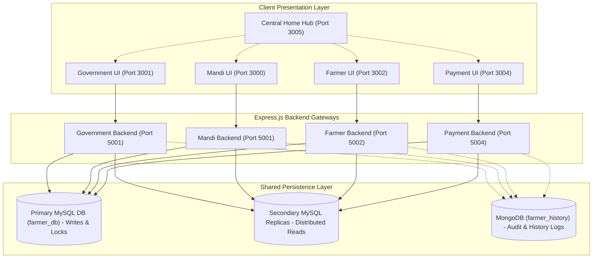
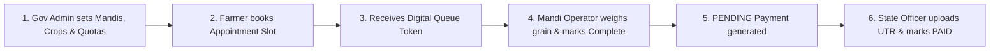

# Digital Agricultural & Mandi Procurement Ecosystem

[](https://nodejs.org/)
[](https://expressjs.com/)
[](https://react.dev/)
[](https://www.mysql.com/)
[](https://www.mongodb.com/)
[]()

A comprehensive, distributed agricultural procurement, market yard logistics, and Direct Benefit Transfer (DBT) disbursement ecosystem developed for the Department of Agriculture, Government of India. The platform unifies administrative regulatory oversight, real-time weighbridge queue sequencing, self-service farmer slot reservations, and state-isolated financial settlements across a shared Primary/Secondary database cluster.

---

## 1. Problem Statement

Traditional agricultural supply chains and Agricultural Produce Market Committee (APMC) yards face severe administrative, logistical, and financial bottlenecks:
- **Chaotic Vehicle Queues**: Farmers queue for days outside mandis with tractor-trolleys without scheduled appointments, causing post-harvest grain spoilage, traffic gridlock, and distress selling to middlemen.
- **Uncalibrated Mandi Throughput**: Market yards lack dynamic capacity controls linking overall daily intake limits to physical weighbridge service rates.
- **Disbursement Delays & Fraud**: Manual reconciliation between scale receipts, land verification, and bank transfers causes weeks of delay in Minimum Support Price (MSP) disbursements.
- **Citizen Data Exposure**: Storing sensitive personal identifiers (such as Aadhaar numbers) or banking credentials in plaintext presents severe privacy and compliance risks.

---

## 2. Proposed Solution

The **Digital Agricultural & Mandi Procurement Ecosystem** resolves these challenges by providing four decoupled, role-specialized web portals and a central navigation gateway connected to a unified relational and document data backbone:
- **Automated 7-Day Appointment Scheduling**: Farmers reserve calibrated delivery slots based on real-time counter capacity and working hours.
- **7-Day Delayed Effective Operational Changes**: Mandi schedule and service-time updates take effect after 7 days, guaranteeing predictability for farmer bookings.
- **Atomic Concurrency & Financial Locks**: Purchases auto-generate payment records in MySQL, and status transitions (`PENDING` &rarr; `PROCESSING` &rarr; `PAID`) execute with row-level locks (`SELECT ... FOR UPDATE`).
- **Two-Tier Aadhaar Protection**: HMAC-SHA256 blind indexing with high-entropy pepper (`AADHAAR_PEPPER`) + irreversible bcrypt storage hashes. Plaintext Aadhaar is never persisted.
- **Primary–Secondary Database Read/Write Splitting**: Application-level database router distributes analytical read queries to secondary replicas while centralizing writes and locks on the Primary database.

---

## 3. Target Users

1. **Farmers & Agricultural Producers**: Self-service onboarding, land documentation, slot reservations, and DBT payout tracking.
2. **Mandi Supervisors & Weighbridge Operators**: Real-time queue sequencing, calling, vehicle arrival tracking, and purchase recording.
3. **State Payment & Finance Officers**: State-isolated ledger auditing, bank reference entry, receipt proof uploads, and payout approvals.
4. **Government Administrators & DBAs**: 3-tier jurisdictional setup (State &rarr; District &rarr; Tehsil), crop catalogs, seasonal procurement quotas, and personnel provisioning.

---

## 4. The Four Portals & Central Hub

| Portal | Main Responsibility | Documentation Link |
|---|---|---|
| **🏛️ Government Portal** | Administrative configuration, crop MSP & quotas, mandi setup, personnel provisioning, and Location-Based Access Control (LBAC) | [Government Portal README](./goverment%20portel/README.md) \| [API Reference](./docs/api/government-api.md) |
| **🌾 Mandi Portal** | Real-time queue sequencing, weighbridge token call/process/complete, counter operator assignment, and 7-day effective schedules | [Mandi Portal README](./mandi%20portel/README.md) \| [API Reference](./docs/api/mandi-api.md) |
| **🚜 Farmer Portal** | Self-service registration, land verification, 7-day appointment slot booking, digital token pass, and payment visibility | [Farmer Portal README](./farmer%20portel/README.md) \| [API Reference](./docs/api/farmer-api.md) |
| **💳 Payment Portal** | State-isolated MSP disbursement ledger, atomic status transitions, proof screenshot attachments, and MongoDB audit logs | [Payment Portal README](./payment-portal/README.md) \| [API Reference](./docs/api/payment-api.md) |
| **🌐 Central Home Hub** | Unified single-click navigation gateway, port configurator, and ecosystem status visualizer | [Home Hub README](./home%20folder/README.md) |

---

## 5. Technology Stack

- **Frontend**: React 19 (`react`, `react-dom`, `react-router-dom`), `lucide-react`, `react-scripts` 5.0.1
- **Backend API Gateway**: Node.js (v18+) with Express.js 5 (`express` ^5.2.1)
- **Relational Database**: MySQL 8.x with `mysql2` connection pooling and Primary/Secondary read-write splitting
- **Document Store**: MongoDB with Mongoose ODM (`mongoose` ^9.x) for immutable audit trails and TTL-indexed logs
- **Session Transport**: HttpOnly, SameSite cookies with dedicated portal cookie names (`gov_token`, `mandi_token`, `farmer_token`, `payment_token`)
- **Cryptography & Security**: `bcrypt` (^6.0.0), `jsonwebtoken` (^9.0.3), crypto (HMAC-SHA256), in-memory JavaScript `Map` rate limiting

---

## 6. High-Level Architecture Diagram



---

## 7. Main Workflow



---

## 8. Database Architecture & Constraint Enforcement

The relational schema (`farmer_db`) enforces strict referential integrity (`ON DELETE RESTRICT`) to protect statutory financial allocations and queue sequences:

```text
To delete a Mandi Counter:
  payment_completion_proof ──> payment ──> queue_token ──> booking ──> mandi_counter

To delete a Booking:
  payment_completion_proof ──> payment ──> booking (queue_token cascades automatically)

To delete User Details:
  Delete the parent user account (triggers block direct deletion of userdetails)
```

👉 **For copy-pasteable SQL transaction scripts, see the [Database Deletion Order Guide](./DATABASE_DELETION_GUIDE.md).**

---

## 9. Comprehensive Documentation System

The complete project documentation is organized in modular guides:

- 🏗️ **[Architecture Documentation](./docs/architecture/README.md)**
  - [System Overview](./docs/architecture/system-overview.md)
  - [Portal Responsibilities](./docs/architecture/portal-responsibilities.md)
  - [Database Routing & Topology](./docs/architecture/database-routing.md)
  - [Architecture Decision Records (ADRs)](./docs/architecture/architecture-decisions.md)
- ⚙️ **[Installation & Setup Guide](./docs/setup/README.md)**
  - [Prerequisites](./docs/setup/prerequisites.md)
  - [Local Development Setup](./docs/setup/local-development.md)
  - [Environment Configuration Guide](./docs/setup/environment-configuration.md)
  - [Database Initialization Order](./docs/setup/database-initialization.md)
  - [Running All Portals Concurrently](./docs/setup/run-all-portals.md)
  - [First Government User Bootstrap Guide](./docs/setup/first-government-user.md)
- 💾 **[Database Documentation](./docs/databases/README.md)**
  - [Shared MySQL Overview](./docs/databases/mysql-overview.md)
  - [Relationships & Constraints](./docs/databases/relationships-and-constraints.md)
  - [Indexes & Analytical Views](./docs/databases/indexes-and-views.md)
  - [Primary–Secondary Replication](./docs/databases/primary-secondary-replication.md)
  - [Backup & Restore Procedures](./docs/databases/backup-and-restore.md)
- 🔐 **[Security Documentation](./docs/security/README.md)**
  - [Authentication Architecture](./docs/security/authentication.md)
  - [Authorization & RBAC/PBAC/LBAC](./docs/security/authorization-and-permissions.md)
  - [Cookie Security & Portal Isolation](./docs/security/cookies-and-sessions.md)
  - [OTP & Server-Side Rate Limiting](./docs/security/otp-and-rate-limiting.md)
  - [Aadhaar Cryptographic Protection](./docs/security/aadhaar-and-personal-data.md)
- 🔄 **[Business Workflows](./docs/workflows/README.md)**
  - [Farmer Registration & Onboarding](./docs/workflows/farmer-registration.md)
  - [Booking, Rescheduling & Slot Allocation](./docs/workflows/booking-and-rescheduling.md)
  - [Mandi Queue & Weighbridge Operations](./docs/workflows/mandi-queue-and-procurement.md)
  - [Payment Lifecycle & State Machine](./docs/workflows/payment-processing.md)
- 🌐 **[API Reference](./docs/api/README.md)**
  - [Government Portal API](./docs/api/government-api.md)
  - [Farmer Portal API](./docs/api/farmer-api.md)
  - [Mandi Portal API](./docs/api/mandi-api.md)
  - [Payment Portal API](./docs/api/payment-api.md)
- 🧪 **[Testing Strategy](./docs/testing/README.md)**
  - [Testing Overview](./docs/testing/testing-strategy.md)
  - [Database Integrity Verification](./docs/testing/database-testing.md)
  - [Security & Rate Limiting Tests](./docs/testing/security-testing.md)
- 📊 **[Project Analysis & Evaluation](./docs/project-analysis/README.md)**
  - [Features & System Benefits](./docs/project-analysis/features-and-benefits.md)
  - [Strengths & Technical Limitations](./docs/project-analysis/strengths-and-limitations.md)
  - [Comparison with Existing Agricultural Platforms](./docs/project-analysis/existing-platform-comparison.md)
  - [Viva & Technical Interview Guide](./docs/project-analysis/viva-and-interview-questions.md)

---

## 10. Known Technical Limitations

1. **Process-Local Rate Limiting**: The in-memory JavaScript `Map` rate limiter is local to each Node.js process. Counters reset on process restart and are not shared across separate instances unless Redis is configured.
2. **Shared Database Migrations**: All four portals share `farmer_db`. Schema alterations must preserve backward compatibility across all portal backends.
3. **Simulated Payment Gateways**: The Payment Portal transitions ledger states and attaches bank reference proofs (UTR numbers), but does not execute direct automated banking API calls (PFMS/NACH).

---

## 11. Contributing & Security Reporting

- Review **[CONTRIBUTING.md](./CONTRIBUTING.md)** for coding standards, branching strategy, and pull request guidelines.
- Review **[SECURITY.md](./SECURITY.md)** for responsible disclosure procedures. Do not report security vulnerabilities via public GitHub issues.

---

## 12. License

This project is licensed under the **ISC License** as defined in portal package configurations. See individual portal package manifests for package-level licensing details.
