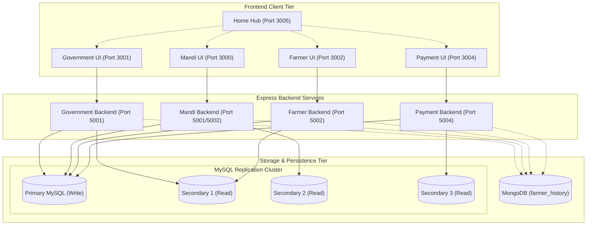

# System Architecture Documentation

This section provides an architectural breakdown of the **Digital Agricultural & Mandi Procurement Ecosystem**, covering system topology, component responsibilities, cross-portal communication, database routing, and architectural decisions.

---

## 📑 In This Section

1. **[System Overview](./system-overview.md)**: High-level architectural topology, multi-tier layout, and shared services.
2. **[Portal Responsibilities](./portal-responsibilities.md)**: Detailed breakdown of the functional boundaries for Government, Mandi, Farmer, Payment, and Home portals.
3. **[Portal Communication & Boundaries](./portal-communication.md)**: Shared database pattern, domain isolation, and loose coupling mechanisms.
4. **[Database Routing & Topology](./database-routing.md)**: Primary (Write) vs Secondary (Read) routing, pool management, and fallback mechanisms.
5. **[Deployment Architecture](./deployment-architecture.md)**: Port allocation, reverse proxies, process management, and multi-process architecture.
6. **[Architecture Decision Records (ADRs)](./architecture-decisions.md)**: Key technical decisions, trade-offs, and design rationale.

---

## 🏛️ Ecosystem High-Level Architecture

