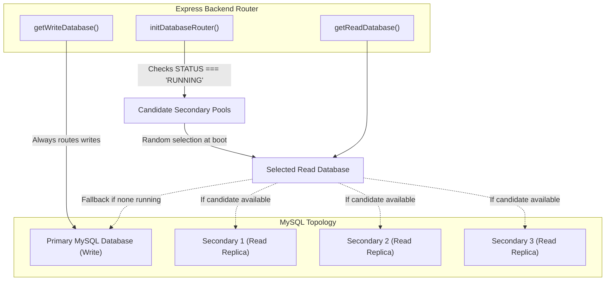

# Database Routing & Topology

Each portal backend integrates a dedicated `databaserouter.js` service that implements **Primary/Secondary read-write splitting** across MySQL connection pools.

---

## 1. Database Topology

The application is structured to connect to:
- **One Primary Database (`PRIMARY_DB`)**: Handles all write operations (`INSERT`, `UPDATE`, `DELETE`), row locking (`SELECT ... FOR UPDATE`), and transactional workflows.
- **Up to Three Secondary Databases (`SECONDARY1_DB`, `SECONDARY2_DB`, `SECONDARY3_DB`)**: Read replicas that handle intensive queries, table listings, and MySQL view inspections.



---

## 2. Selection & Fallback Algorithm

1. **Pool Creation**: On module load, `initDatabaseRouter()` creates independent connection pools for `PRIMARY_DB` and all configured `SECONDARY` databases using `mysql2.createPool()`.
2. **Status Filtering**: The router inspects environment variables (`SECONDARY1_DB_STATUS`, `SECONDARY2_DB_STATUS`, `SECONDARY3_DB_STATUS`). Only pools where `status === "RUNNING"` and the host is configured are considered candidates.
3. **Random Candidate Selection**:
   ```javascript
   const runningDatabases = secondaryDatabases.filter(
       item => item.db && item.status === "RUNNING"
   );

   if (runningDatabases.length === 0) {
       console.warn("No Secondary DB is running. Using Primary DB for reads.");
       selectedReadDatabase = primaryDB;
       selectedReadDatabaseName = "PRIMARY (fallback)";
   } else {
       const randomIndex = Math.floor(Math.random() * runningDatabases.length);
       selectedReadDatabase = runningDatabases[randomIndex].db;
       selectedReadDatabaseName = runningDatabases[randomIndex].name;
   }
   ```
4. **Primary Fallback**: If no Secondary database is marked `RUNNING` or reachable, all read traffic automatically routes to `PRIMARY_DB`, ensuring zero downtime during replica maintenance.

---

## 3. Consistency Considerations & Limitations

- **Replication Lag**: Because MySQL replication between Primary and Secondary instances can experience asynchronous lag, reading immediately after writing across separate database connections could yield stale reads. Critical state transitions (such as payment status changes in `paymentTransitionService.js`) execute entirely on the Primary connection with `START TRANSACTION; ... SELECT ... FOR UPDATE; ... COMMIT;`.
- **Health Checks**: Startup verification executes `SELECT 1` on both Primary and the selected Read database via `verifyDatabaseConnections()`. If the Primary fails, server initialization aborts safely.
