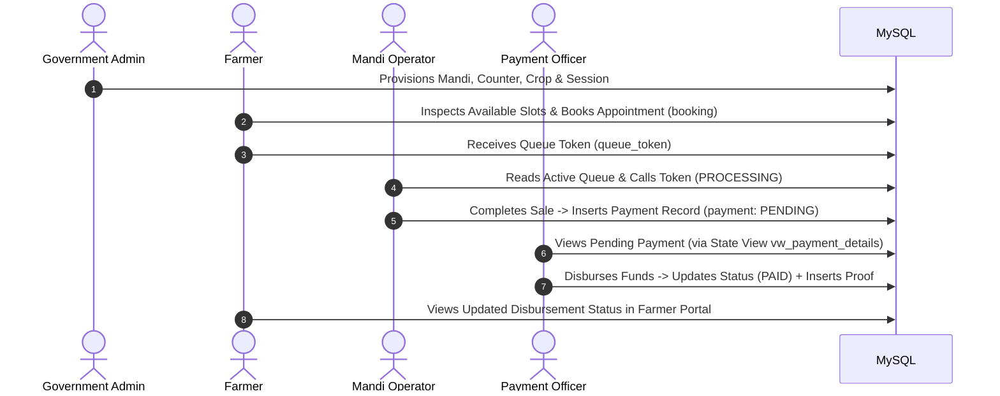

# Portal Communication & Integration Boundaries

In this ecosystem, the four portals communicate through a **Shared Database Integration Pattern** rather than direct synchronous HTTP microservice calls. This document details how data flows across boundaries, how isolation is preserved, and why this design was selected.

---

## 1. Shared Database Architecture

Instead of point-to-point REST or gRPC calls between portals, all four portal backends connect to a shared MySQL relational database (`farmer_db`) and a shared MongoDB document database (`farmer_history`):

---

## 2. Advantages of the Shared Database Pattern

1. **ACID Relational Guarantees**:
   - Cross-domain transactions (such as counter capacity checks, booking creation, and quota deduction) execute within atomic MySQL transactions without requiring complex two-phase commit (2PC) or distributed sagas.
2. **Referential Integrity Enforcement**:
   - Foreign key constraints (`ON DELETE RESTRICT`) ensure that operational records (such as completed payments) cannot become orphaned if a counter or mandi is altered.
3. **Optimized Read Views**:
   - Complex reporting queries (e.g., joining farmer profile, bank details, land records, counter info, and payment status) are evaluated directly in MySQL via optimized read views (`vw_payment_details`, `vw_booking_queue`, `vw_mandis`).
4. **Zero Microservice Latency & Network Overhead**:
   - No inter-service network hops or API rate-limit bottlenecks between internal backend processes.

---

## 3. Boundary & Domain Isolation Controls

To prevent cross-portal interference while sharing the database, strict architectural safeguards are enforced:

### A. Dedicated Cookie Names
Each portal backend sets and verifies its own distinct HttpOnly cookie:
- Government: `gov_token`
- Mandi: `mandi_token`
- Farmer: `farmer_token`
- Payment: `payment_token`

This ensures that logging into one portal on `localhost` does not overwrite or invalidate active sessions in another portal.

### B. Table Ownership & Write Boundaries
- Only the **Government Portal** writes to `crop`, `procurement_quota`, `procurement_session`, `mandi`, `mandi_counter`, `app_users`, and `payment_users`.
- Only the **Farmer Portal** writes to `booking` (initial creation and cancellation).
- Only the **Mandi Portal** writes to `queue_token` (status progression), `mandi_timing`, `mandi_working_day`, and inserts initial `payment` rows.
- Only the **Payment Portal** updates `payment.payment_status` and writes to `payment_completion_proof`.

### C. Location-Based Access Control (LBAC)
The Government Portal enforces dynamic SQL query scoping (`applyLocationScope`), restricting queries according to the officer's administrative jurisdiction (`state_id`, `district_id`, `tehsil_id`). Similarly, the Payment Portal isolates all ledger queries strictly by `state_id`.
