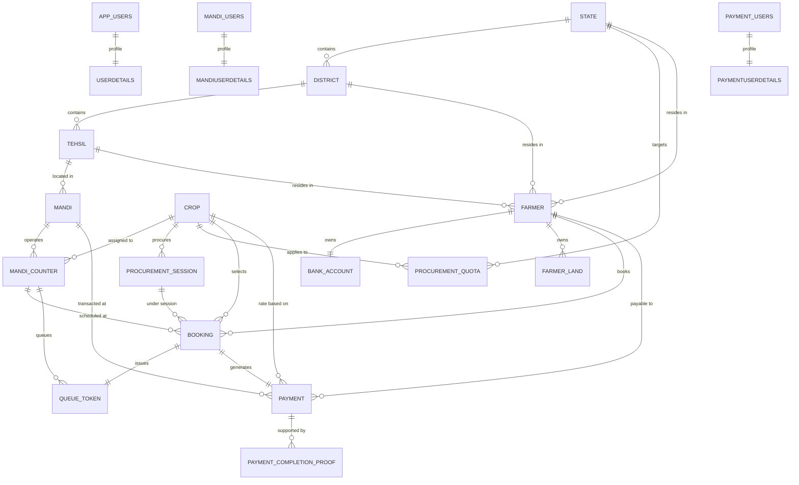

# Database Architecture & Schema Documentation

This section provides in-depth technical documentation of the relational MySQL database (`farmer_db`) and document MongoDB database (`farmer_history`), covering table definitions, foreign key constraints, indexes, views, replication topology, and backup procedures.

---

## 📑 In This Section

1. **[MySQL Overview & Shared Schema](./mysql-overview.md)**: Global database engine settings, character sets, and cross-portal shared architecture.
2. **[Government Database Schema](./government-database.md)**: Tables owned/managed by the Government Portal (`state`, `district`, `tehsil`, `crop`, `procurement_quota`, `procurement_session`, `app_users`, `userdetails`).
3. **[Farmer Database Schema](./farmer-database.md)**: Tables owned/managed by the Farmer Portal (`farmer`, `bank_account`, `farmer_land`, `booking`).
4. **[Mandi Database Schema](./mandi-database.md)**: Tables owned/managed by the Mandi Portal (`mandi`, `mandi_timing`, `mandi_working_day`, `mandi_counter`, `counter_avg_time`, `counter_service_time`, `queue_token`, `mandi_users`, `mandiuserdetails`, `mandi_user_counters`).
5. **[Payment Database Schema](./payment-database.md)**: Tables owned/managed by the Payment Portal (`payment`, `payment_completion_proof`, `payment_users`, `paymentuserdetails`).
6. **[MongoDB Design & History Collections](./mongodb-design.md)**: Document schemas, TTL indexes, and operational history retention in `farmer_history`.
7. **[Relationships & Foreign Key Constraints](./relationships-and-constraints.md)**: Relational integrity rules, cascading vs restrict behavior, and cross-reference to the [Database Deletion Order Guide](../../DATABASE_DELETION_GUIDE.md).
8. **[Indexes & MySQL Read Views](./indexes-and-views.md)**: Composite indexes, unique indexes, and pre-joined analytical MySQL views.
9. **[Primary–Secondary Replication & Router](./primary-secondary-replication.md)**: MySQL replication topology, pool management, lag mitigation, and router implementation.
10. **[Backup & Restore Procedures](./backup-and-restore.md)**: Enterprise mysqldump recipes, binary log point-in-time recovery, and MongoDB dumps.
11. **[Schema Migrations & Table Evolution](./migrations-and-schema-changes.md)**: Safe schema change rules, zero-downtime alterations, and trigger preservation.

---

## 📊 Complete Entity-Relationship (ER) Overview

