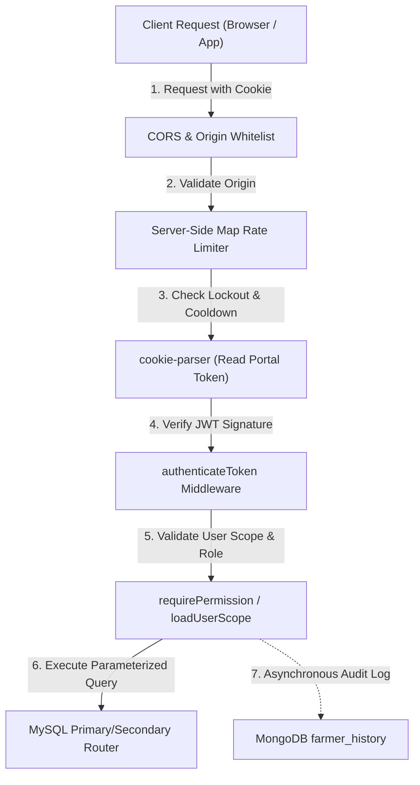

# Security & Access Control Documentation

This section provides comprehensive technical documentation on the cryptographic mechanisms, session architectures, rate limiting systems, and privacy safeguards implemented across the platform.

---

## 📑 In This Section

1. **[Authentication Architecture](./authentication.md)**: Phone + OTP flows, JWT signing, password verification, and session creation.
2. **[Authorization & RBAC / PBAC / LBAC](./authorization-and-permissions.md)**: Role-Based, Permission-Based, and Location-Based Access Control models.
3. **[Cookie Security & Portal Isolation](./cookies-and-sessions.md)**: HttpOnly, SameSite, domain scoping, and dedicated cookie names (`gov_token`, `mandi_token`, `farmer_token`, `payment_token`).
4. **[OTP & Server-Side Map Rate Limiting](./otp-and-rate-limiting.md)**: Dedicated JavaScript `Map` store for tracking failed attempts, lockout hours, and 5-minute resend cooldowns.
5. **[Aadhaar & Personal Data Protection](./aadhaar-and-personal-data.md)**: HMAC-SHA256 blind indexing with `AADHAAR_PEPPER` + bcrypt storage hash to protect citizen identity.
6. **[Database Security & SQL Injection Defense](./database-security.md)**: Parameterized queries, connection security, and transaction boundaries.
7. **[Audit Logging & Compliance](./audit-logging.md)**: Tamper-evident MongoDB audit logging (`PaymentLog`, `LoginLogs`) and TTL retention.

---

## 🛡️ Security Architecture Overview

