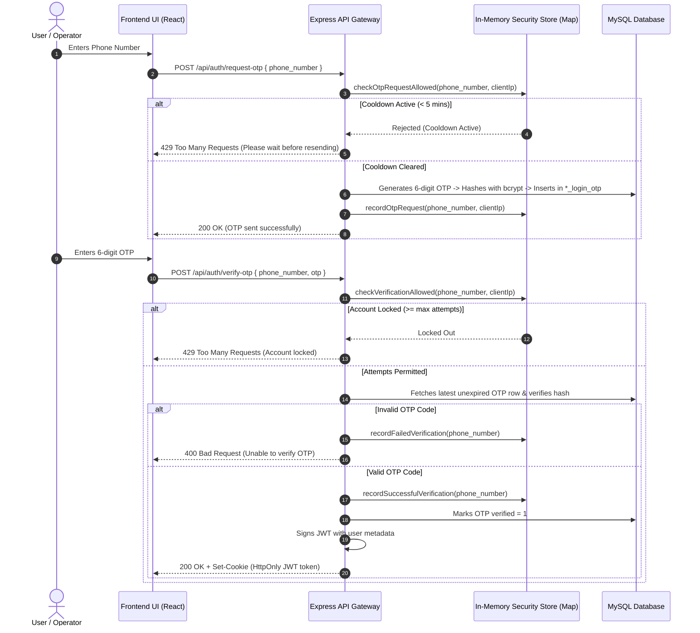

# Authentication Architecture

The platform supports secure, modern authentication paradigms tailored to government administrative personnel and rural agricultural producers.

---

## 1. Authentication Modalities

The system supports two primary authentication models:
1. **Phone Number + Cryptographic OTP Verification**:
   - Primary flow for **Farmers**, **Mandi Counter Operators**, **Payment Officers**, and **Government Officers**.
   - No passwords stored for standard users; authentication relies on mobile verification.
2. **Administrative 2FA / Password Overrides**:
   - For high-privilege administrative operations (e.g. DBA user creation in the Government Portal, or modifying 7-day Mandi operating hours), a secondary verification password (`GOV_SECURITY_VERIFICATION_PASSWORD`, `MANDI_TIMING_SETTINGS_PASSWORD`) is enforced.

---

## 2. Phone + OTP Authentication Workflow



---

## 3. JWT Payload Structure & Validation

When authentication succeeds, a JSON Web Token is signed using `jsonwebtoken`:

```json
{
  "user_id": 1148,
  "username": "dist_officer_rohtak",
  "role": "district_admin",
  "permissions": ["read", "write", "update"],
  "state_id": 1126,
  "district_id": 1229,
  "tehsil_id": null,
  "iat": 1775836800,
  "exp": 1775923200
}
```

- Tokens are signed with `JWT_SECRET` using HMAC-SHA256 (`HS256`).
- Expiration (`exp`) defaults to 24 hours (`1d`) or 1 hour (`1h`).
- Protected routes read the token using `authenticateToken.js` / `authMiddleware.js`, decode the claims, and populate `req.user` and `req.userScope`.
