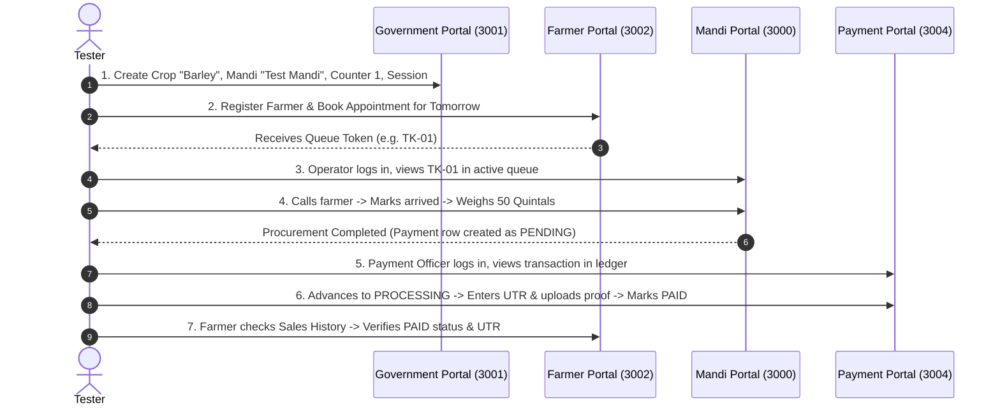

# Integration & Cross-Portal Flow Testing

This guide walks through manual end-to-end integration testing across all four portals to verify that data changes propagate accurately across the entire procurement lifecycle.

---

## 1. Complete End-to-End Test Scenario

---

## 2. Verification Checklist

During execution, verify:
1. [ ] **Quotas Deduct Correctly**: Verify that booking reduced available quota in `procurement_quota`.
2. [ ] **7-Day Delay Verification**: If changing operating hours in the Mandi Portal, verify that the farmer portal displays the *current* hours for appointments within the next 6 days, and the *new* hours starting on day 7.
3. [ ] **Cross-Portal Session Integrity**: Verify that logging in or logging out of the Mandi Portal does not log the user out of the Payment or Government portal.
4. [ ] **MongoDB Logs Emitted**: Verify in MongoDB Compass or mongosh that `TokenHistory` and `PaymentLog` documents were created with operator usernames and timestamps.
