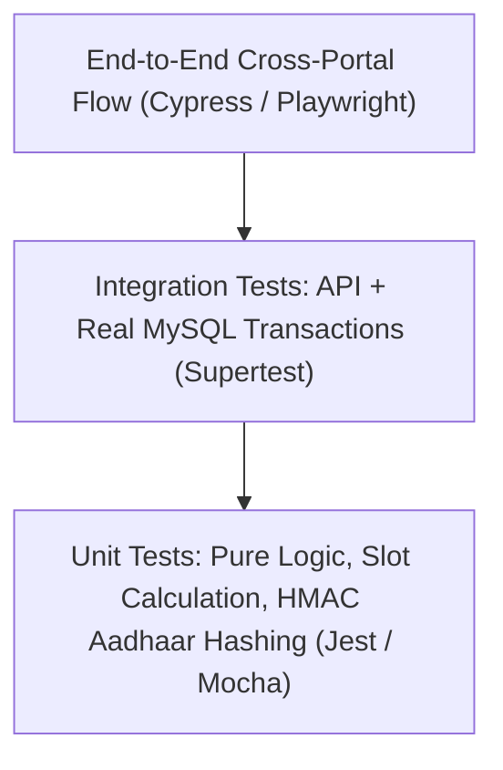

# Testing Strategy Overview

This document describes the testing practices, available scripts, and recommended automated testing approaches for the codebase.

---

## 1. Existing Test Infrastructure Status

During codebase inspection:
- Frontends include Jest and React Testing Library setup (`@testing-library/react`, `react-scripts test`).
- Backends currently define placeholder npm test scripts (`"test": "echo \"Error: no test specified\" && exit 1"`).
- Database seeding scripts (`scripts/seed_demo_data.js` in Mandi Portal) and startup connection verifiers (`verifyDatabaseConnections()`) serve as local smoke tests.

---

## 2. Recommended Test Pyramid for the Ecosystem

To establish enterprise test coverage:

### A. Unit Tests
- Test pure utility functions:
  - `aadhaarSecurity.js`: Verify deterministic HMAC generation and salt randomness.
  - `slotService.js`: Verify slot generation and 7-day effective date evaluation.
  - `locationScope.js`: Verify SQL query string alteration across different user scopes.

### B. Integration Tests
- Test Express routes using `supertest` with a local test MySQL database (`farmer_test_db`).
- Verify HTTP status codes (`200`, `400`, `403`, `429`).
- Verify that HttpOnly cookies are set with expected flags.

### C. End-to-End Tests
- Test the full lifecycle across browser UIs: Farmer registers &rarr; Books slot &rarr; Mandi calls token &rarr; Sale completed &rarr; Payment disbursed.
