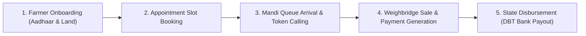

# Business Workflows Documentation

This section provides detailed end-to-end operational walkthroughs of the core business workflows supported by the ecosystem, from initial farmer onboarding to final bank disbursement.

---

## 📑 In This Section

1. **[Farmer Registration & Onboarding](./farmer-registration.md)**: Citizen signup, blind index Aadhaar hashing, land verification, and bank detail binding.
2. **[Booking, Rescheduling & Slot Allocation](./booking-and-rescheduling.md)**: Quota validation, counter capacity checks, slot availability calculation, and appointment issuance.
3. **[Mandi Queue, Weighbridge & Procurement](./mandi-queue-and-procurement.md)**: Physical gate arrival, weighbridge processing, operator calling, and purchase record generation.
4. **[Payment Lifecycle & Disbursement](./payment-processing.md)**: State-isolated ledger review, status progression (`PENDING` &rarr; `PROCESSING` &rarr; `PAID`), transaction proofs, and audit logging.
5. **[Government Administration & Quotas](./government-administration.md)**: State quota target allocation, seasonal session configuration, and user provisioning.
6. **[Cancellation, No-Show & Failure Recovery](./cancellation-and-failure-recovery.md)**: Appointment cancellation, no-show status handling, and payment retry workflows.

---

## 🔄 End-to-End Procurement Lifecycle

