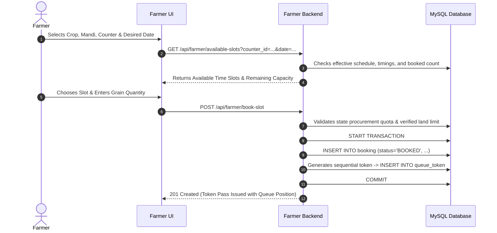

# Booking, Rescheduling & Slot Allocation Workflow

The appointment booking engine allows registered farmers to schedule grain delivery appointments at specific mandi counters up to 7 days in advance.

---

## 1. Slot Generation & Availability Algorithm

Slot availability is computed dynamically (`services/slotService.js`):
1. **Target Date Window**: Allowed dates span from `Tomorrow` to `+7 Days` (`CURDATE() + INTERVAL 7 DAY`).
2. **Effective Mandi Schedule Check**:
   - The engine checks `mandi_working_day` for the requested day of the week (e.g. Wednesday).
   - If a pending working day change exists, the engine checks whether `effective_date <= targetDate`. If effective, the pending schedule applies; otherwise, the current schedule applies.
   - Closed days return zero available slots.
3. **Effective Operating Hours Check**:
   - Opening and closing hours are fetched from `mandi_timing` (accounting for any 7-day effective date delay).
4. **Counter Average Service Time**:
   - Fetches `average_time_minutes` from `counter_service_time` / `counter_avg_time` (default 15 minutes per tractor-trolley).
   - Total available slots = $\frac{\text{Closing Time} - \text{Opening Time}}{\text{Average Service Time}}$.
5. **Capacity Calculation**:
   - Subtracts already booked appointments (`SELECT SUM(quantity_approved) FROM booking WHERE counter_id = ? AND DATE(booking_time) = ?`).
   - If remaining capacity is greater than the farmer's requested load, the slot is declared available.

---

## 2. Appointment Booking Workflow

---

## 3. Rescheduling & 30-Minute Cancellation Window

- **Rescheduling**: Farmers can reschedule an unserved appointment up to 24 hours prior to the booked service date. The previous queue token position is cancelled, and a new token is sequenced for the revised date.
- **Cancellation Lock**: If a farmer attempts to cancel within 30 minutes of counter opening time on their service date, cancellation is restricted to prevent counter underutilization.
