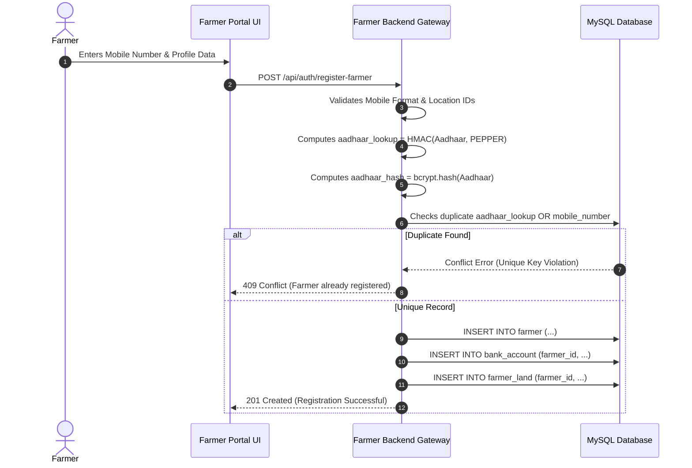

# Farmer Registration & Onboarding Workflow

Farmer registration qualifies agricultural producers to participate in government grain procurement at Minimum Support Prices (MSP).

---

## 1. Prerequisites for Onboarding

To register, a farmer must provide:
- Valid Indian 10-digit mobile number.
- 12-digit Aadhaar number for identity verification.
- Residential location (State, District, Tehsil).
- Land parcel information (Survey/Khasra number, area in acres, ownership type).
- Bank account details (Account number, IFSC code, bank name) matching the farmer's legal identity.

---

## 2. Step-by-Step Registration Workflow

---

## 3. Data Integrity & Verification Rules

1. **Aadhaar Protection**: The 12-digit raw number is immediately discarded from memory once hashes are generated.
2. **Land Verification**: Newly inserted land parcels default to `land_verification = 'pending'`. Administrative officers in the Government Portal verify ownership against land registry databases before seasonal quotas can be booked.
3. **Single Active Bank Account**: The `bank_account.farmer_id` column enforces `UNIQUE KEY`, guaranteeing each farmer has exactly one primary bank account on file for Direct Benefit Transfer disbursements.
