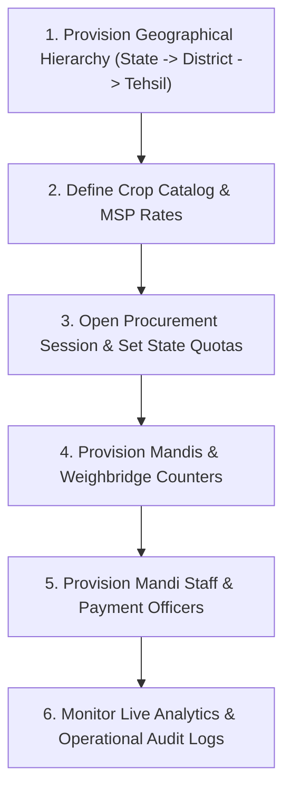

# Government Administration & Quotas Workflow

The Government Portal provides executive oversight and controls regulatory policy across all agricultural markets, seasonal procurement quotas, and personnel provisioning.

---

## 1. Administrative Workflow Lifecycle

---

## 2. Seasonal Session & Quota Allocation

1. **Procurement Session Creation**:
   - Administrative officers define the seasonal procurement window (`start_date`, `end_date`) and commodity crop type (Rabi, Kharif, or Zaid).
2. **State Quota Targets**:
   - Under `procurement_quota`, the government sets the statutory ceiling:
     - `amount`: Maximum total grain quantity (in quintals) the state is authorized to purchase.
     - `msp`: Minimum Support Price guaranteed to farmers.
     - `lsp`: Lower Selling Price floor.
3. **Quota Enforcement During Booking**:
   - When a farmer initiates a booking in the Farmer Portal, the system aggregates existing bookings against the state quota:
     $$\sum \text{quantity\_approved} + \text{requested\_quantity} \le \text{Quota Target}$$
   - If the total exceeds the state quota, bookings are paused, preventing government over-expenditure.

---

## 3. User Administration & Provisioning

Only authorized Database Administrators (DBAs) and System Administrators can provision officer accounts:
- **Government Officers (`app_users`)**: Assigned location scoping (`state_id`, `district_id`, `tehsil_id`) and permission arrays.
- **Mandi Personnel (`mandi_users`)**: Assigned to specific mandis, and linked to physical counters via `mandi_user_counters`.
- **Payment Officers (`payment_users`)**: Assigned to state jurisdictions for disbursement control.
- **Two-Factor Administrative Protection**: Modifying or creating accounts requires entering `GOV_SECURITY_VERIFICATION_PASSWORD`.
