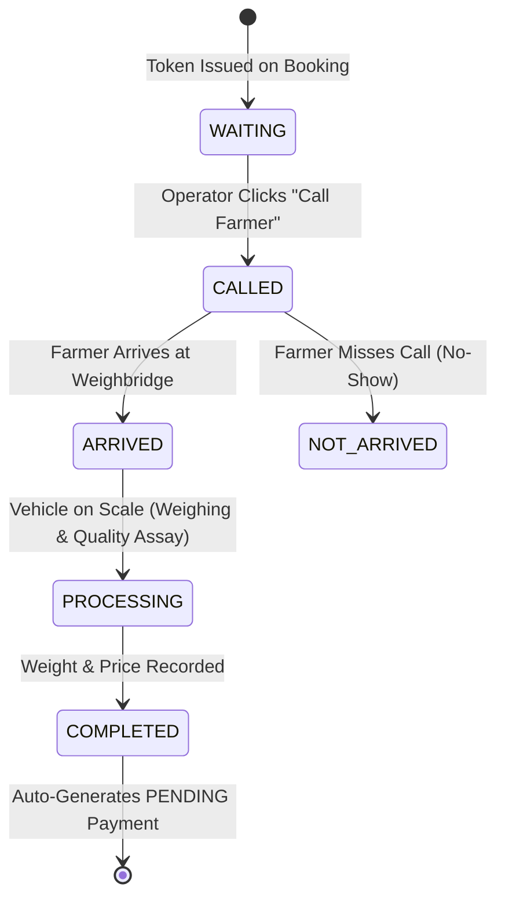

# Mandi Queue, Weighbridge & Procurement Workflow

The Mandi Portal manages physical market yard operations, sequencing farmer arrivals at weighbridges, and recording official procurement purchases.

---

## 1. Daily Operator Workflow & Queue Lifecycle

When counter operators log into the Mandi Portal:
1. **Operator-Counter Association**: The operator selects their assigned physical counter (validated via `mandi_user_counters`).
2. **Live Queue Screen**: The operator views the active queue (`vw_booking_queue`) for the current service date sorted by `queue_position ASC`.

---

## 2. Step-by-Step Operator Actions

### Step 1: Call Farmer (`CALLED`)
- Operator triggers `/api/tokens/:tokenId/call`.
- The token record updates `status = 'CALLED'`, setting `called_at = NOW()`.
- The live status board and farmer's portal reflect that their tractor-trolley is called to the scale.

### Step 2: Mark Arrival (`ARRIVED`)
- When the farmer enters the weighbridge lane, operator triggers `/api/tokens/:tokenId/arrive`.
- Updates `arrival_time = NOW()`.

### Step 3: Begin Weighing & Quality Assay (`PROCESSING`)
- Operator inspects grain quality against Fair Average Quality (FAQ) standards and weighs gross vehicle weight.
- Triggering `/api/tokens/:tokenId/process` updates `processing_start_time = NOW()`.

### Step 4: Purchase Completion & Payment Generation (`COMPLETED`)
- After dumping grain and recording tare vehicle weight, net grain weight (`quantity_sold`) is computed.
- The operator triggers `/api/tokens/:tokenId/complete` with `{ quantity_sold, rate_per_unit }`.
- **Atomic Transaction**:
  1. Updates `queue_token` to `status = 'COMPLETED'`, setting `completion_time = NOW()`.
  2. Updates parent `booking` to `status = 'COMPLETED'`.
  3. Inserts a new record into `payment`:
     - `payment_status = 'PENDING'`
     - `total_payable_amount = quantity_sold * rate_per_unit`
     - `generated_by_user_id = req.user.user_id`
  4. Records event snapshot in MongoDB `TokenHistory` and `PaymentHistory`.
