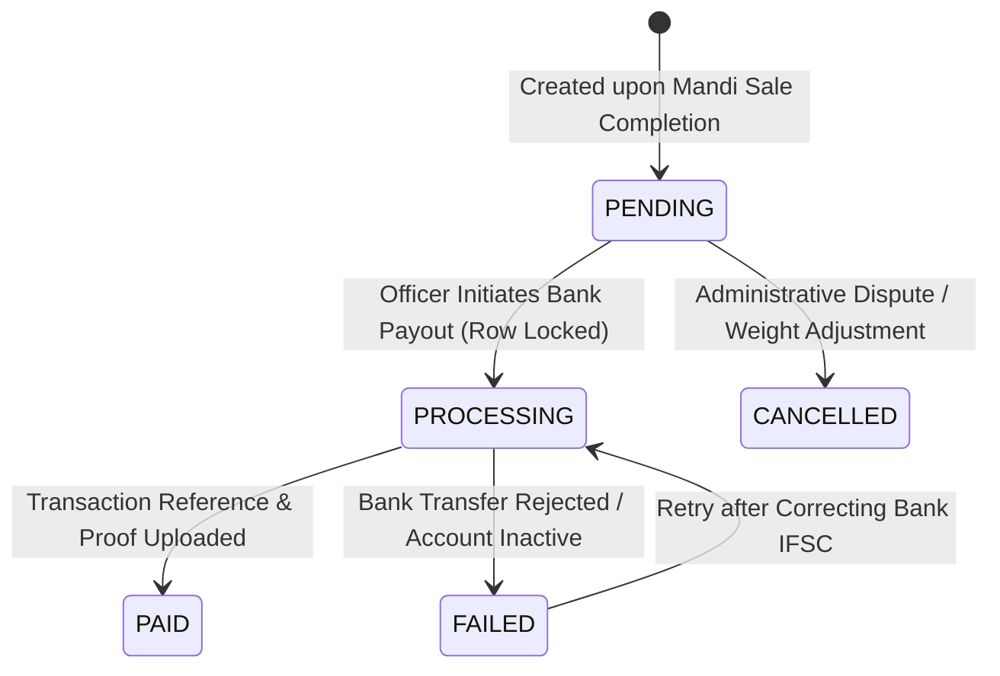

# Payment Lifecycle & Disbursement Workflow

The Payment Portal manages state-isolated government financial disbursements for completed agricultural purchases.

---

## 1. Payment Lifecycle State Machine



---

## 2. State Isolation & Scoped Ledgers

Payment officers log into the Payment Portal and are strictly scoped by their assigned Indian state (`state_id` in `payment_users`).
- Officers cannot inspect, approve, or disburse payments belonging to other states.
- The backend enforces this via the pre-joined analytical view `vw_payment_details` combined with mandatory `WHERE f.state_id = req.user.state_id` filtering.

---

## 3. Atomic Status Transition Workflow (`paymentTransitionService.js`)

When an officer updates a payment (e.g. from `PROCESSING` to `PAID`):

1. **Acquire Exclusive Row Lock**:
   ```sql
   START TRANSACTION;
   SELECT * FROM payment WHERE payment_id = ? FOR UPDATE;
   ```
2. **Validate Valid Transition**:
   - `PENDING` &rarr; `PROCESSING` (Authorized)
   - `PROCESSING` &rarr; `PAID` (Requires `transaction_reference` and screenshot proof)
   - `PROCESSING` &rarr; `FAILED` (Requires explanatory reason)
   - Invalid transitions (e.g. `PAID` &rarr; `PENDING`) are rejected with HTTP 400.
3. **Persist Transaction Proof (`payment_completion_proof`)**:
   - Stores bank transaction UTR reference (`transaction_reference`).
   - Stores operator ID, completion timestamp, and notes.
   - Stores optional base64 bank payment screenshot.
4. **Commit & Asynchronous Audit Log**:
   ```sql
   UPDATE payment 
   SET payment_status = 'PAID', payment_date = NOW() 
   WHERE payment_id = ?;
   COMMIT;
   ```
   - Emits an asynchronous non-blocking event to MongoDB `PaymentLog` capturing executing officer details, IP address, and status timestamps.
